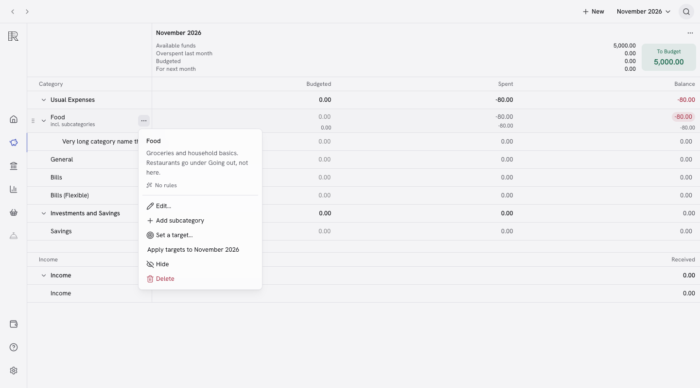
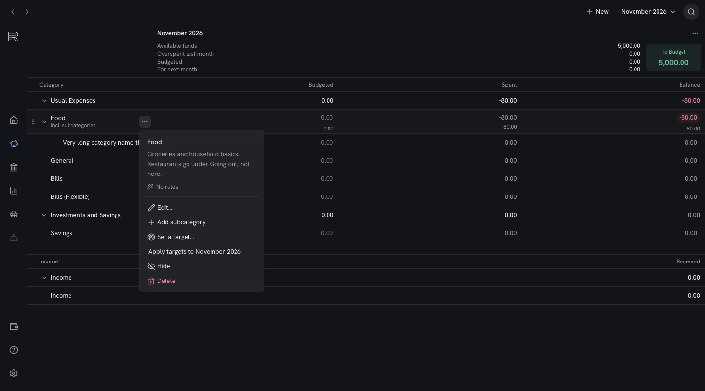
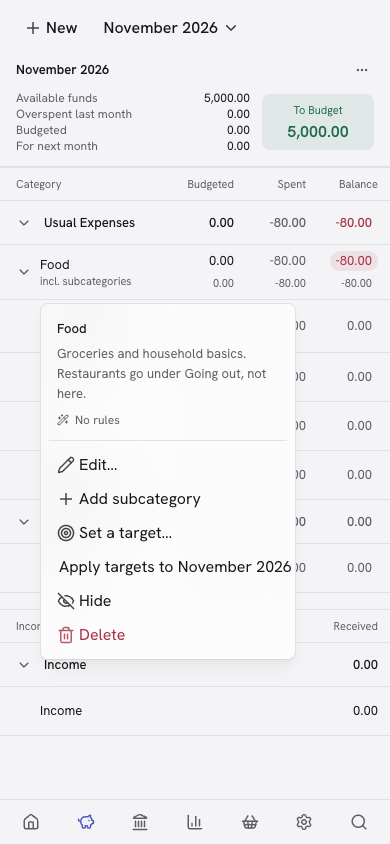

The card a row opens in the budget grid (`apps/web/src/components/categories/category-card.tsx`, [shell rules](../../../../docs/rules/shell.md)) holds a category or group's name, details and actions. It works but was built for function first, and needs a design pass as a whole, not only the items below.

## Seen so far

- "Apply targets to November 2026" has no icon, unlike the other actions, and is the longest line by far. With three months shown it repeats three times.
- The card covers part of the column it opens from, including the rows just below.
- Actions are one flat list. Edit, structure, targets, visibility and the destructive Delete have no grouping.
- The name repeats what the row already says, and "No rules" is the same weight whether it matters or not.
- A row with no description has nothing to invite adding one. The rule count does not lead to the rules.
- On a phone a tap on the name opens this, a tap on the figures opens the category sheet, and neither says so. Those two surfaces overlap on targets.

Start from the `devl` skill and how the app's other popovers look. Check it at 390x844 and at desktop width, in Day and Night.
