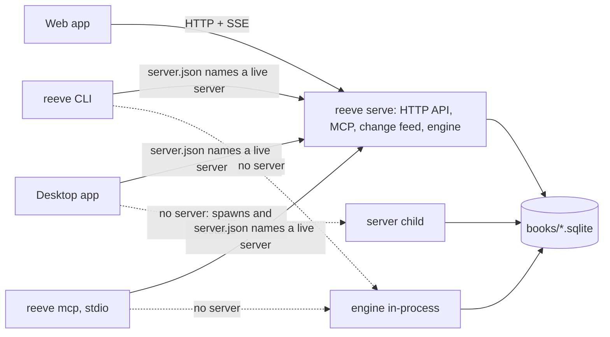

# Architecture

This page says which process and which package does what, as the code is today. When a change
moves a process's or a package's job, update this page in the same commit.

## Processes

- `reeve serve` runs the server on 127.0.0.1 (port 4620 by default): the API at `/api`, OpenAPI at
  `/api/openapi.json`, MCP at `/mcp`, the SSE change feed at `/api/events`, and the built web app.
  It claims its home with a lock, writes `<home>/server.json` once it listens and removes it when
  it closes ([boundaries rules](rules/boundaries.md),
  [boundaries rules](rules/boundaries.md)).
- `reeve <command>` and `reeve mcp` go through `connect()`. A server that `server.json` names and
  that answers `/api/health` with the same version runs every call over HTTP. With no server, a
  dead pid or a refused connection, the engine runs in-process; a server of another version, or one
  that does not answer, is reported instead
  ([boundaries rules](rules/boundaries.md)).
- The desktop app attaches to the server `server.json` names, or spawns one as a child, restarts it
  when it crashes, and loads the web app from the server's origin. Quitting stops the child; an
  attached server keeps running
  ([scope rules](rules/scope.md)).
- The web app calls operations by name over HTTP and refreshes a book's queries when the change
  feed names the book ([boundaries rules](rules/boundaries.md)).

Every process opens a book the same way: one SQLite file in WAL mode, each write operation in one
immediate transaction and one undo step
([boundaries rules](rules/boundaries.md), [boundaries rules](rules/boundaries.md)).
When the CLI embeds the engine next to a running server, SQLite's lock makes them take turns.

## Frozen purchases

Purchases is retained but disabled by `FEATURES.purchases` in `contract/src/features.ts`
([purchases rules](rules/purchases.md)). The complete catalog keeps its
types and historical definitions; `availableCatalog()` supplies the public operations and inputs to
HTTP, MCP, connections, CLI, the generated browser routes and the skill. Direct engine calls are
gated too. Purchase pages have route guards, and navigation, register controls, item reports,
automation settings and the photo endpoint are unavailable.

`engine/src/receipts/compatibility.ts` remains wired into the composition root to maintain old
references and protect previously applied splits from automatic recategorization. Migrations,
tables, undo, photo recovery and backup sidecars stay active. The subsystem descriptions below
include retained source, not a claim that purchase functionality is enabled. See the
[freeze specification](specs/purchases-freeze.md) for ownership and acceptance gates.

## The home

| Path                                | What                                                                                      |
| ----------------------------------- | ----------------------------------------------------------------------------------------- |
| `<home>/books/<id>.sqlite`          | One book: its ledger, budget, rules, schedules, reports, receipts and undo log            |
| `<home>/bank/`                      | The bank provider's private key (mode 0600) and application id, never in a book           |
| `<home>/receipts/<book>/<receipt>/` | The book's receipt photos, one folder per receipt ([purchases rules](rules/purchases.md)) |
| `<home>/config.json`                | `defaultBook`, the book an operation uses when `book` is left out                         |
| `<home>/server.json`                | `url`, `pid` and `version` of the running server                                          |
| `<home>/.server-lock`               | The lock a running server holds                                                           |

`<home>` is `REEVE_HOME`, else `$XDG_CONFIG_HOME/reeve`, else `~/.config/reeve`.

## Packages

Packages depend in one direction: `contract` ← `engine` ← `mcp` ← `server` ← `cli`, with `client`
on `engine`, and `ui` ← `apps/web`
([boundaries rules](rules/boundaries.md)).

| Package             | What                                                                                                                                                                                                                                                                                                                                                                                                                                                                                                                                                                                                                                                                                                                                                                                                                                                                                                                                                                                                                                                                                                                                                                                                                                                                                                                                                                                                                                                                                                                                                                                                                                                                                                                                                                         |
| ------------------- | ---------------------------------------------------------------------------------------------------------------------------------------------------------------------------------------------------------------------------------------------------------------------------------------------------------------------------------------------------------------------------------------------------------------------------------------------------------------------------------------------------------------------------------------------------------------------------------------------------------------------------------------------------------------------------------------------------------------------------------------------------------------------------------------------------------------------------------------------------------------------------------------------------------------------------------------------------------------------------------------------------------------------------------------------------------------------------------------------------------------------------------------------------------------------------------------------------------------------------------------------------------------------------------------------------------------------------------------------------------------------------------------------------------------------------------------------------------------------------------------------------------------------------------------------------------------------------------------------------------------------------------------------------------------------------------------------------------------------------------------------------------------------------- |
| `packages/contract` | What every client shares. `domain.ts`: the Effect schemas and tagged errors. `catalog.ts` and `catalog/<domain>.ts`: every operation, declared once ([boundaries rules](rules/boundaries.md)). `api.ts`: the HttpApi definition generated from the catalog plus `AppGroup` ([boundaries rules](rules/boundaries.md)). `client.ts`: the typed `fetch` client. `operations.ts` and `routes.gen.ts`: calling operations by name from the browser. `rules.ts`: plain functions both sides run (dates, money, `computeBudget`); `receipts.ts` the same for receipts (line arithmetic, units, allocation, matching scores, splits); `targets.ts` budget targets as structured data, their plain sentences and Actual's editor checks ([budget rules](rules/budget.md)); `monte-carlo.ts` Actual's Monte Carlo retirement simulation, which the engine runs and the browser reads defaults and labels from ([boundaries rules](rules/boundaries.md)).                                                                                                                                                                                                                                                                                                                                                                                                                                                                                                                                                                                                                                                                                                                                                                                                                               |
| `packages/engine`   | The domain on SQLite through Drizzle. `db/`: the schema, the bundled migrations, `openDatabase` and the undo triggers. `ledger/`: accounts, categories (nested inside groups to the book's `categoryDepth`, [model rules](rules/model.md)), payees, transactions and the register. `budget/`: the computed budget view (with each category's rolled-up total) and budget actions. `rules/`, `schedules/`, `imports/` (bank-file parsers, reconciliation, the payee derived from a line's text through per-country profiles in `payee-profiles.ts` for files and bank sync alike, CSV and backup export, [bank rules](rules/bank.md), [bank rules](rules/bank.md)), `bank/` (read-only bank sync through a provider the person registers: its adapter, the mapping to import rows, the fetch budget and the scheduler, [bank rules](rules/bank.md)), `reports/` (each dashboard widget's report over the report lines in `lines.ts`, which count transfers and opening balances the way Actual does; the balance forecast projects schedules forward and Monte Carlo simulates a retirement plan, both in the engine, [boundaries rules](rules/boundaries.md)), the dashboards and widgets, `templates/` (budget targets: Actual's goal and cleanup templates in category notes, read and written as structured targets, [budget rules](rules/budget.md)), `receipts/` (itemized receipts with their own tables in `receipts/schema.ts`, matching, applying as splits, products, prices, photos on disk; [purchases rules](rules/purchases.md)): one folder per further domain, each with its `handlers.ts`. `books.ts`: the `Books` service (create, open, list, default, the change stream). `home.ts`: the home's files. `operations.ts`: the handlers and `runOperation`. |
| `packages/mcp`      | MCP tools generated from the catalog on Effect's `McpServer`: `stdioLayer` runs them through the CLI's connection, `httpLayer` on the server's `Books`.                                                                                                                                                                                                                                                                                                                                                                                                                                                                                                                                                                                                                                                                                                                                                                                                                                                                                                                                                                                                                                                                                                                                                                                                                                                                                                                                                                                                                                                                                                                                                                                                                      |
| `packages/server`   | `startServer`: the Effect HttpApi server in one router, with `operations.ts` running every endpoint through `runOperation`, `app.ts` the health, connection and change-feed endpoints, `receipt-photos.ts` the route that streams a receipt photo's bytes, and `home-claim.ts` the home lock.                                                                                                                                                                                                                                                                                                                                                                                                                                                                                                                                                                                                                                                                                                                                                                                                                                                                                                                                                                                                                                                                                                                                                                                                                                                                                                                                                                                                                                                                                |
| `packages/client`   | `connect()` and the `Connection` service: each call runs on the server over HTTP (`remote.ts`) or on the engine in-process (`embedded.ts`). `findServer` is the probe it shares with `reeve serve` and the desktop app.                                                                                                                                                                                                                                                                                                                                                                                                                                                                                                                                                                                                                                                                                                                                                                                                                                                                                                                                                                                                                                                                                                                                                                                                                                                                                                                                                                                                                                                                                                                                                      |
| `packages/cli`      | `reeve` on `effect/cli`. `commands.ts` and `schema-flags.ts` generate a command per catalog entry with a `cli` field, `render.ts` prints results, `skill.ts` writes the agent skill, and `reeve.ts` adds `serve`, `mcp` and `skills export` and the shared `--book` flag.                                                                                                                                                                                                                                                                                                                                                                                                                                                                                                                                                                                                                                                                                                                                                                                                                                                                                                                                                                                                                                                                                                                                                                                                                                                                                                                                                                                                                                                                                                    |
| `packages/ui`       | The UI kit: coss ui components, `cn`, hooks, date labels and `styles.css` (design tokens, fonts). It imports no reeve package.                                                                                                                                                                                                                                                                                                                                                                                                                                                                                                                                                                                                                                                                                                                                                                                                                                                                                                                                                                                                                                                                                                                                                                                                                                                                                                                                                                                                                                                                                                                                                                                                                                               |
| `apps/web`          | Vite and React with TanStack Router and Query and XState. Routes: the budget, an account's register, payees (recent ones first, from `payee_activity`, [rules and payees rules](rules/rules-and-payees.md)), rules (`rule_activity`, [rules and payees rules](rules/rules-and-payees.md)), schedules (`schedule_activity`, [rules and payees rules](rules/rules-and-payees.md)), an account's overview (`account_activity`, [ledger rules](rules/ledger.md)), receipts (`receipt_activity`, [purchases rules](rules/purchases.md)), products (`product_activity`, `product_summary`, [purchases rules](rules/purchases.md)), reports and settings. These pages share `components/insights/`. `lib/api.ts` keys every query by its book; `machines/sync.ts` follows the change feed.                                                                                                                                                                                                                                                                                                                                                                                                                                                                                                                                                                                                                                                                                                                                                                                                                                                                                                                                                                                          |
| `apps/desktop`      | Electron shell. `main.ts` owns the window, `backend.ts` attaches to or spawns and restarts the server child in `server.ts`, `problem.ts` is the page that says why there is no server, `preload.ts` gives the web app `window.reeve`, and `cli-link.ts` puts the shipped `reeve` on the PATH.                                                                                                                                                                                                                                                                                                                                                                                                                                                                                                                                                                                                                                                                                                                                                                                                                                                                                                                                                                                                                                                                                                                                                                                                                                                                                                                                                                                                                                                                                |
| `apps/landing`      | The project's landing page, built from devl blocks. `pnpm --filter landing screenshots` recaptures its app screenshots from a seeded scratch book. Its vendored blocks get relaxed type flags and lint rules, and `scripts/restyle.ts` reapplies the page's look to them after a block is reinstalled.                                                                                                                                                                                                                                                                                                                                                                                                                                                                                                                                                                                                                                                                                                                                                                                                                                                                                                                                                                                                                                                                                                                                                                                                                                                                                                                                                                                                                                                                       |
| `packages/e2e`      | End-to-end tests of the web app against the real server (`pnpm test:e2e`); bank-file fixtures in `fixtures/`.                                                                                                                                                                                                                                                                                                                                                                                                                                                                                                                                                                                                                                                                                                                                                                                                                                                                                                                                                                                                                                                                                                                                                                                                                                                                                                                                                                                                                                                                                                                                                                                                                                                                |

## Reports

Each dashboard widget of Actual is an operation in `contract/src/catalog/reports.ts` with its engine
code in `engine/src/reports/`, so agents get the same numbers as the web app's cards
(`apps/web/src/components/reports/`) and full pages (`apps/web/src/routes/reports.*.tsx`). Saved
definitions live in `custom_reports`; placements in `widgets` link through `report_id` and keep
typed `config` for title, presentation and scope. A report widget renders its saved report's
settings, and a full report page opened from it (`?report=`) saves back to that definition, so
every linked placement follows. Local Home widgets need no saved report. Private legacy JSON stays
unchanged. `reports/initialize.ts` converts old records and seeds Today once at book open, before
schedule advancement. It clears pre-upgrade undo/redo once ([reports rules](rules/reports.md)); later writes use normal undo.

`components/reports/widgets.ts` is the one registry of widget types: kind (report, summary, work
list, text), default title, minimum size, add-menu entry, font-size support, the whole-number
settings Widget settings offers (Coming up's days ahead), content and where the widget leads.
Home's old panels are its local widgets (`components/home/widgets.tsx`: the month's status,
category pace, account balances, coming up) beside latest transactions and the spending report, and
each reads its own query. Content that holds links of its own (`hasLinks`) is not wrapped in the widget's target. `WidgetCard` renders any widget in whatever box its host gives it; `WidgetQuery`
tells a first load, a failed load with Retry, an empty result and a failed refresh over kept
figures apart (`widget-state.ts`), and an error boundary keeps a crash inside its card. Types the
registry does not know, missing saved reports and unreadable settings say so and offer Remove.
A report that follows accounts runs with its effective scope: the full report's, a fixed
placement's, the page's for a widget on Transactions or Payees (`WidgetHostContext`), else its saved
report's (`effectiveScope` in `contract/src/rules.ts`). The report operations AND that `scope` with
their conditions ([reports rules](rules/reports.md)).
Dashboard listing is read-only. Saved report deletion checks the reviewed placement ids and removes
those placements and the definition in one transaction. Default selection belongs to the book;
Transactions and Payees each hold an optional stack of up to three report widgets per book
(`list_page_widgets`, `add_page_widget`, `move_page_widget`), in a `dashboard_pages` row with `host`
set that the dashboard operations never touch. Home's Dashboards tab
(`routes/index.tsx`) creates, renames, duplicates, reorders, resets and deletes dashboards and picks
the one that opens by default. `/?dashboard=` names the dashboard; `/` alone is the book's default,
so a launch or reload opens it, and a `?dashboard=` naming one that is gone shows the default under
an info alert. Arranging
is an explicit mode. `DashboardGrid` saves each completed drag, resize or arrow-key step as one
`update_widgets` (one undo step) and shows it until the refetch lands. The arrow keys on a card's
handle move it and Shift with them resizes it (`nudge` in `grid-layout.ts`). Below a 720px
container the grid is one column in reading order (row, column, id), and Move up and Move down
exchange a card with its neighbour (`swapWithNeighbour`).

Home holds Dashboards and Reports as two tabs ([reports rules](rules/reports.md)).
`/reports` is All reports, and every report keeps the tabs, with the report selector
(`components/reports/report-selector.tsx`) in the bar's `context` slot after them. A tab marked
`resumes` in `lib/nav.ts` links to the page of it this window showed last in the book
(`lib/home-session.ts`, memory only), and so do the sidebar's Home, the phone bar, `h` and `r`.
`/reports/library` and `/reports?page=` redirect to `/reports` and `/?dashboard=`.
A report page keeps its unsaved settings in the address as `explore`, replacing the history entry
on each change, and its Save menu writes them over the saved report or into a new one
(`components/reports/report-state.ts`, [reports rules](rules/reports.md)).
Back and Forward return the page's one scroller to where that entry was (`lib/scroll-memory.ts`).
A report figure that names an exact record set opens those records in the frame's pane, and a row
opens its editor there with a way back to the list. The records come from an operation beside the
report over the same lines, each row with what it counts toward the figure
(`FigureRecords`), so the list sums to the figure. Spending's category cells (`spending_transactions`) and the
Budget page's spent and received cells and group totals (`budget_transactions`, a parent
with its subcategories) use it, through
`FigureRecordsPane` in `components/figure-records.tsx`; a figure without such an
operation has no record action ([reports rules](rules/reports.md)).

Most reports read the report lines of `reports/lines.ts`: one
line per posting on an asset or liability account, with its counterpart category or transfer
account; opening balances are lines with no category.

- `budget_analysis_report` (Budget Analysis): per month what the expense categories were budgeted
  and spent, last month's overspending reset by categories that do not roll it over, and the
  running balance, from the computed budget (`budget/view.ts`). Only category filters apply.
- `sankey_report` (Sankey): Actual's flow graph, in `reports/sankey-graph.ts`. "Spent" runs from
  payees through income categories and accounts to category groups and categories; opening
  balances come in as "Starting Balances". "Budgeted" runs from income through the budget to what
  each category was given, with the month before's carry-in and the next month's hold; money that
  entered the budget without an income category is "Other income". Columns, the top-N fold into
  "Other" and the sort orders are Actual's.
- `age_of_money_report` (Age of Money): Actual's FIFO lots over budget accounts, leaving out
  transfers between them; the age is the average of the last ten outflows, per day, week (from
  Monday) or month.

## Scripts

| Script                         | What                                                                                                                                                                                |
| ------------------------------ | ----------------------------------------------------------------------------------------------------------------------------------------------------------------------------------- |
| `scripts/bundle-migrations.ts` | Writes drizzle-kit's migrations into `engine/src/db/migrations.gen.ts`; `pnpm db:generate` runs it.                                                                                 |
| `scripts/routes.ts`            | Writes each available operation's method and path into `contract/src/routes.gen.ts`; `pnpm catalog:generate` runs it.                                                               |
| `scripts/check-desktop.ts`     | Builds the web app and `apps/desktop`, fails when a bundle loads a module it does not carry, and starts the bundled server and CLI outside the repo; the last step of `pnpm check`. |
