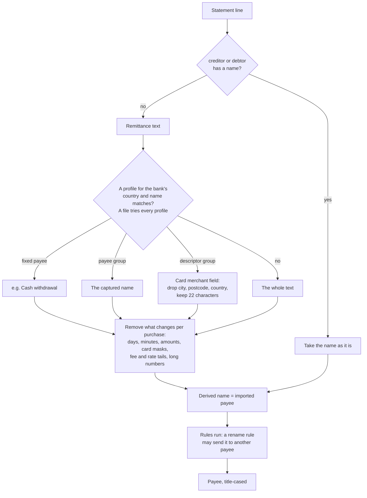
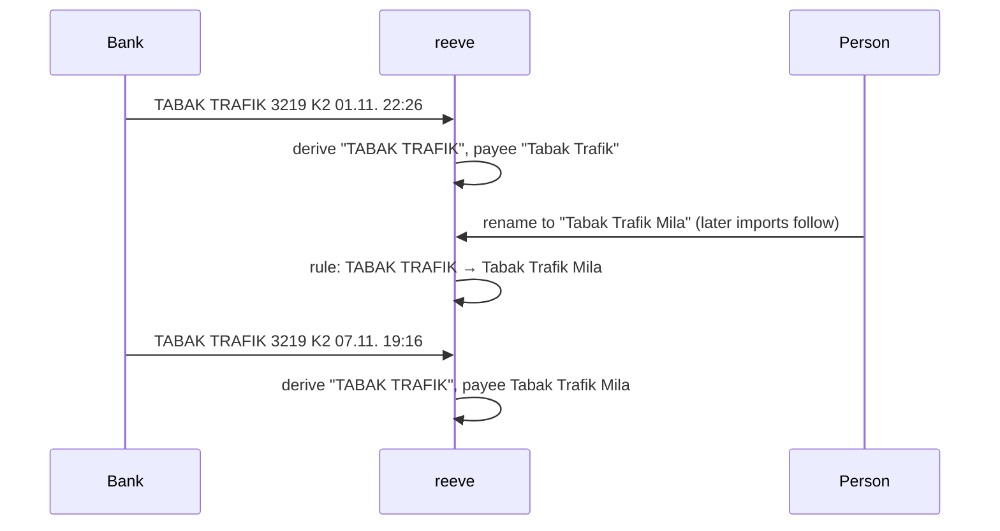
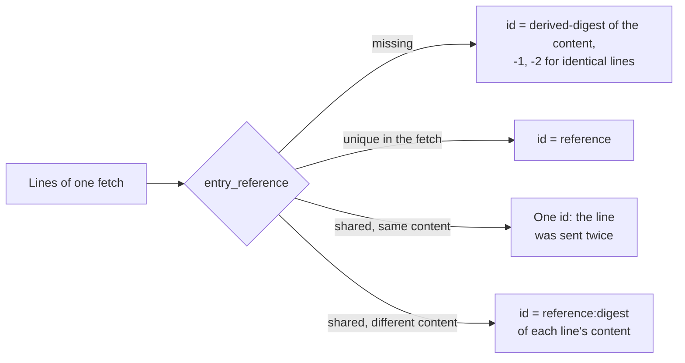

# Bank payees

How reeve turns a bank's statement line into a payee, why that is hard, and what the alternatives
cost. It does the same for a line of a bank file. The decisions are [bank rules](rules/bank.md)
and, for files, [bank rules](rules/bank.md).
How to set up bank sync is in [Bank sync](bank-sync.md).

## The problem

A bank tells you the other party of a transfer by name. For a card payment it often does not. Erste
sends a card payment like this through Enable Banking:

```json
{
  "entry_reference": "209900000001XYZ-000A0EXAMPLE",
  "transaction_amount": { "currency": "EUR", "amount": "11.50" },
  "credit_debit_indicator": "DBIT",
  "creditor": null,
  "remittance_information": ["TABAK TRAFIK 4100  K2   04.11. 16:20"]
}
```

The only trace of the shop is free text, and it changes with every purchase: `K2` is the card,
then the day and the minute. Taken whole as the payee, every purchase makes a new payee. On a
test account, nearly every card payee was like that.

The banking app shows "Tabak Trafik Mila" for the same line. That name is not in what the bank
sends. The app adds it itself, so no parser can recover it.

### What the provider promises

Enable Banking's [API reference](https://enablebanking.com/docs/api/reference/) makes three fields
of a transaction required: `transaction_amount`, `credit_debit_indicator` and `status`. Everything
else may be missing, including `creditor`, `debtor`, `remittance_information`,
`merchant_category_code` and every date. The [market pages](https://enablebanking.com/docs/markets/)
cover how to sign in at each bank, not what data each bank sends. The [FAQ](https://enablebanking.com/docs/faq)
says Enable Banking does no categorisation or enrichment, that some banks send no entry reference,
and that some "provide duplicate values even though they should not".

So each bank writes its lines its own way, and nothing in the API says how.

## How reeve derives a payee



The code is `payeeFromText` in `packages/engine/src/imports/payee-text.ts`. Bank sync runs it in
`mapLine` (`bank/rows.ts`) before the row reaches `importRows`.

### Bank files

A bank's CSV, OFX, QIF or CAMT export carries the same text where the payee goes. `prepareFile`
(`imports/prepare.ts`) runs each row's payee text through `payeeFromText`, so `preview_import`
shows the derived name and `import_transactions` takes it as the imported payee. When the name
differs from the text and the row has no notes, the notes keep the text.

- **Every profile applies.** A file names no bank, and each profile matches only its own format.
- **On by default.** `derivePayees: false` takes the payee as the file writes it, as Actual does.
  The import dialog has no switch for it: a name the derivation spoils (`24/7 Fitness` becomes
  `Fitness`) is still stable, so one rename fixes every later file.
- **One rule for both.** A shop's file lines and its fetched lines give the same imported payee, so
  one rename rule covers both.

Three layers do the work. Each one handles what the one before cannot.

1. **Profiles** read a known format precisely. Austria's card payments put the merchant's name in
   the first 12 characters (`TABAK TRAFIK 3219  K2 …`), or after the time for POS and online
   payments (`POS 70,90 AT K2 28.10. 14:44 BILLA DANKT 1598 HAUPTSTRASSE 1010 040`). Erste,
   Raiffeisen and easybank all write lines this way. Actual's GoCardless code parses the same
   format for Raiffeisen and easybank.
2. **Noise removal** works for any bank. Days, minutes, amounts and terminal numbers are what make
   one purchase's text differ from the next, whatever the bank's layout.
3. **The person's rules** handle the rest: a name only they know ("Mila"), or two different shops
   that read the same.

### Stable beats pretty

The derived name does not have to read well. It has to be the same every time. `SP* NORTHWIND` is
an odd payee name, but every Northwind line produces it, so one rename to "Northwind" fixes
every later line too. A parser that sometimes produces a nicer name and sometimes another is worse.

### Measured on a test account

Deriving the name cut the distinct payees to about a third. The 50 most common derived names
cover 60% of the lines, and the top 200 cover 80%. What remains
is real variation (`MCDONALDS194`, `BURGER KING HAUPTBAHNH`) and shops seen once. A parser cannot
remove that; merges and renames by the person can.

## Teaching it once



- **Rename or merge with "Send later imports".** `update_payee` and `merge_payees` take
  `renameImports`. The imported names on the payee's transactions, and its former names, join the
  payee's rename rule (`renameFutureImports` in `engine/src/rules/learn.ts`). The web app turns
  this on by default, with a switch to turn it off.
- **Suggested merges.** `suggest_payee_merges` groups payees whose words, without digits and
  punctuation, begin with another payee's words: `Spar`, `Spar Dankt`, `Spar 4824`. The Payees page
  and the account's register both show "N groups of payees look like one", so a fetch or an import
  that brings a look-alike payee points at it where it landed. Review lists each group, and one
  click merges it with later imports following. **Keep apart** records the pair in `payees_apart`,
  and that group is not suggested again.
- **Scoped to the accounts in view.** With `account` or `onBudget`, `suggest_payee_merges` keeps the
  groups with a payee that has a transaction on those accounts. The groups stay whole: `Spar` from
  another account still joins `Spar Dankt` fetched into this one. Both pages ask in the Accounts
  scope, so under "every account" they list every group.

A suggestion is never applied by itself. `Trafik` and `Trafik Otto` look alike but can be two
different shops.

## By account number

A transfer or a direct debit names the other party's account, so a rule can match the number
instead of the text ([bank rules](rules/bank.md)).
The rule condition **Counterparty account** (`counterparty_account`) reads the debtor's account for
money in and the creditor's for money out, compared without spaces or case. It matches only
transactions with a kept bank line.

An account number names a bank account, not a payee. On an Erste account, every card payment
carried `2099000000000000`, Erste's own card clearing account, and Klarna's one IBAN covered three
shops. A rule on such a number would catch every shop behind it.

The Rules page offers these rules from the kept lines
([bank rules](rules/bank.md)),
through `suggest_account_rules`:

- **Rule: always P.** Two or more lines from one account, all on payee P under one imported payee.
  An account seen under several payee texts, as the two above, is never offered. One click makes
  the pre-stage rule `counterparty_account is X → payee P`.
- **Make transfers to L.** The number is one of your own linked accounts. One click makes the rule
  `counterparty_account is X → transfer to L` and applies it to the lines already in, merging the
  other bank's copy of each movement into the transfer.
- **Dismiss** keeps a number from being offered again. A number a rule already matches is not
  offered either.

## Which line is which

Matching a fetched line to one already in the book rests on `entry_reference`. Banks get it wrong
in two ways.



Erste's quarterly closing books Kontoführung, KESt, Habenzinsen and a zero "Abschlussbuchung"
under one reference. `lineIds` in `bank/rows.ts` gives each line the reference plus a digest of its
content, so every fetch names the four lines the same way and none of them reads as a conflict.

Some banks send no reference at all. `lineIds` then derives an id from the line's day, amount,
currency, direction, parties and remittance, as Actual does, so a line the person deleted stays out
of later fetches. Nothing tells two identical lines apart, such as two tolls on one day, so they are
two purchases numbered in the bank's order. When one stops coming, the last of them in the book is
the one left unmatched. Only lines that can be imported take a number.

## Complications to keep in mind

- **Truncated names.** Austria's short card format keeps 12 characters (`BAECKEREI902`). Card
  networks keep 22 for the merchant (`CITY PARKING GARAGE NO`). The name is cut, not wrong, and stays
  stable.
- **Shops that read the same.** `TABAK TRAFIK 2362` and `TABAK TRAFIK 3219` both derive "TABAK
  TRAFIK". The four digits are not a shop id: Erste uses `2362` for four different shops. Only the
  person can split them, with a rule on the notes.
- **City words.** The merchant field ends in a city that may be two words (`SAN FRANCISCO`). reeve
  drops the last word and keeps 22 characters, which suits most lines and stays stable on the rest.
- **Languages.** Fee tails are `SPESEN`, `KURS`, `GEBÜHR`, `FEE`. A bank in another language adds its
  words to a profile or to the noise list.
- **Raw text is still there.** The notes keep the bank's full text. A rule that needs the terminal
  number or the city matches on the notes.
- **Strangers write this text.** Anyone who sends a transfer chooses its remittance. It is data for
  the book and for an agent on MCP, never instructions ([bank rules](rules/bank.md)).

## Adding a bank's format

1. Get a few lines from the bank: the remittance text of card payments, withdrawals and fees, with
   personal details removed.
2. Add a profile to `PAYEE_PROFILES` in `packages/engine/src/imports/payee-profiles.ts`, or a pattern
   to an existing profile for the country. Give each pattern a `payee` group, a `descriptor` group
   for a card merchant field, or a fixed `payee`.
3. Add each line to the profile's `samples` with the payee it must give.
4. Run `npx vitest run packages/engine/test/bank-payees.test.ts`.

A format the noise removal already handles well needs no profile.

## Alternatives

| Approach                            | What it covers                    | Upkeep                                             | Privacy                                 | Where reeve stands               |
| ----------------------------------- | --------------------------------- | -------------------------------------------------- | --------------------------------------- | -------------------------------- |
| Code per bank (Actual's GoCardless) | Each bank someone wrote, well     | High; breaks silently when a bank changes its text | Local                                   | Not as code; as data in profiles |
| Noise removal for every bank        | Most card lines anywhere, roughly | Low                                                | Local                                   | Built                            |
| Profiles as data with samples       | Known formats, precisely          | Low; a contribution is data                        | Local                                   | Built, Austria first             |
| Learning from merges and renames    | What only the person knows        | None                                               | Local                                   | Built                            |
| Paid enrichment                     | The best names where offered      | Contract and cost per user                         | Every transaction goes to a third party | Not now                          |
| An agent proposing renames over MCP | What is left                      | None                                               | Depends on the agent                    | Possible later                   |

### Services that sell cleaned names

None of these is used. They are here for the day reeve becomes a hosted product whose subscription
could pay for one.

| Service                                                                                                       | What it returns                                                                                                                                               | Coverage and notes                                                                                     |
| ------------------------------------------------------------------------------------------------------------- | ------------------------------------------------------------------------------------------------------------------------------------------------------------- | ------------------------------------------------------------------------------------------------------ |
| [Plaid](https://plaid.com/docs/api/products/transactions/)                                                    | `merchant_name` cleaned from the raw `name`, `counterparties`, `personal_finance_category` with a confidence level, `logo_url`, a stable `merchant_entity_id` | Plaid's own bank connections, mainly North America and the UK; Europe through its open banking product |
| [Tink](https://tink.com/products/merchant-information/)                                                       | Merchant Information within Data Enrichment: a clean brand name, logo, more than 50 categories, address and website                                           | Listed for Belgium, Denmark and France, with other European markets announced                          |
| [GoCardless Bank Account Data](https://docs.gocardless.com/docs/bank-account-data/output-transaction-details) | Raw fields like Enable Banking's; a paid "Enriched Bank Data" tier is said to add a display name                                                              | The enrichment page could not be read, so its details are unconfirmed                                  |
| Enable Banking                                                                                                | No enrichment ([FAQ](https://enablebanking.com/docs/faq))                                                                                                     | It points to specialised providers                                                                     |

Each one would mean sending a person's transactions to the service, which goes against reeve's
local-only design ([scope rules](rules/scope.md)), and paying
per user or per call.
