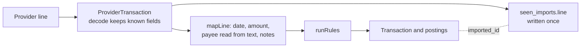
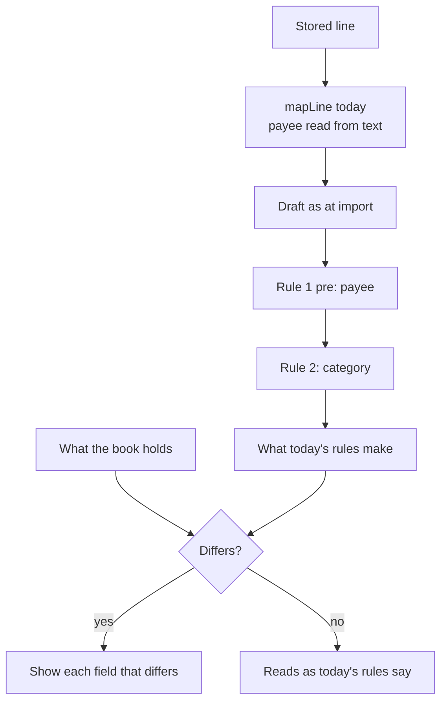

# Bank line provenance

Accepted in [bank rules](../rules/bank.md); slice 1 has landed. It keeps
what the bank sent for each line, so a person can see how a transaction came to look the way it
does, run today's rules on the original, and see which old transactions a new rule would change.
The decision amends
[bank rules](../rules/bank.md) (what `seen_imports` holds)
and [rules and payees rules](../rules/rules-and-payees.md) (what rewrites
history). How a payee is read from a line is in [Bank payees](../bank-payees.md).

## The idea

Keep the bank's data for each transaction as an immutable record, "so that we'd know what the
original was, what rules and transformations we applied to it so it became what it became." On top
of that record:

- **Revert.** Return one or many transactions to the original and reapply the rules.
- **Preview.** On any transaction, see what the current rules make of its original.
- **Backtest.** After adding rules, see which imported transactions would change if they were
  derived again from their original, and apply that.
- **A workbench.** Original data on one side, rules to create and edit, and what the data becomes.

In short, keep the line and show today's rules on it inside the transaction's pane. Everything else
is one operation that rebuilds transactions from their lines, with a dry run that the rule editor
shows. No workbench page, no separate revert, and no stored record of past rule runs.

## What reeve keeps today

A fetched line goes through `mapLine` in `engine/src/bank/rows.ts`, then `importRows` in
`engine/src/imports/reconcile.ts` runs the rules on it and writes the result. Some of the original
survives, in places anyone can change.

| What the bank sent        | Where it lands today                                             | Can it change later?                      |
| ------------------------- | ---------------------------------------------------------------- | ----------------------------------------- |
| `entry_reference`         | `postings.imported_id`, `seen_imports`                           | No                                        |
| Amount, direction         | the posting's amount                                             | Only by an edit, never once reconciled    |
| Booking or value date     | `transactions.date`                                              | By an edit or a rule                      |
| Creditor or debtor name   | the payee, and `imported_payee`                                  | Payee by anyone; `imported_payee` by rule |
| Remittance text           | the notes, joined into one string                                | By an edit or a rule                      |
| Payee read from the text  | `imported_payee`                                                 | By a rule                                 |
| Revolut's two lines apart | joined or split by position, then gone                           | Lost at import                            |
| Value date beside booking | dropped                                                          | Lost at import                            |
| The bank's name, country  | on the connection, which a person can remove                     | Lost with the connection                  |
| The rules that ran        | nowhere ([rules and payees rules](../rules/rules-and-payees.md)) | Never recorded                            |

`seen_imports` already holds a row per line an account took: its id, date, amount and the payee the
rules gave it. It stays outside undo and survives deletes, so a dismissed line stays out.

## What Actual does

Actual added `raw_synced_data` to `transactions` in migration `1739139550000_bank_sync_page.sql`.
`normalizeBankSyncTransactions` in `loot-core/src/server/accounts/sync.ts` writes
`JSON.stringify(trans)`, the provider's line after Actual's own changes to it. When a fetched line
merges into an existing transaction, the first value wins (`existing.raw_synced_data ??
trans.raw_synced_data`). Its only reader is the bank sync settings page
(`useBankSyncAccountSettings.ts`), which takes one stored line as the example for choosing which
field becomes the payee, the notes and the date.

Actual has no revert, no preview of a transaction against its original and no backtest. Its rule
editor lists "This rule applies to these transactions" with **Apply actions**, which reeve already
has as `preview_rule` and `apply_rules`. Everything past keeping the line departs from Actual.

## Keep the line beside its id

Each `seen_imports` row gets a `line` column: JSON, written once, when the account first takes the
line.

```json
{
  "source": "bank",
  "bank": { "name": "Erste Bank und Sparkassen", "country": "AT" },
  "currency": "EUR",
  "line": {
    "entry_reference": "209900000001XYZ-000A0EXAMPLE",
    "transaction_amount": { "currency": "EUR", "amount": "11.50" },
    "credit_debit_indicator": "DBIT",
    "status": "BOOK",
    "booking_date": "2026-11-03",
    "value_date": "2026-11-03",
    "remittance_information": ["TABAK TRAFIK 4100  K2   04.11. 16:20"]
  }
}
```

`line` is the provider's transaction exactly as it arrived, every field included: counterparty
names and account numbers, `merchant_category_code`, `bank_transaction_code` and fields reeve does
not read yet. The adapter keeps the raw object beside what `ProviderTransaction` in
`engine/src/bank/client.ts` decodes, so a later reading, or a rule on a field reeve learns to read,
can use what the bank sent. `bank` and `currency` are what `mapLine` needs besides the line, so the line can be
read again after the connection is gone. The sample is 329 bytes, so 2,000 lines would take about
0.7 MB (an estimate from one line, not measured on the book).



### Why there and not on the transaction

| Where                                | Transfers                         | Merges                                   | Undo                                              | Lines with no id  |
| ------------------------------------ | --------------------------------- | ---------------------------------------- | ------------------------------------------------- | ----------------- |
| Column on `transactions` (Actual)    | Two bank lines, one row: one lost | Needs a rule for which wins              | Every edit copies the JSON into the undo log      | Covered           |
| Column on `postings`                 | One per side                      | The dropped posting's line is lost       | Same, and every `select()` of postings carries it | Covered           |
| Own table by posting id, as receipts | One per side                      | `mergeTransactions` must move it         | A new entry in `UNDONE_TABLES`                    | Covered           |
| **`seen_imports.line`**              | One per side, by each side's id   | Follows `imported_id`, which merges move | Outside undo already; written once                | Not until REE-123 |

A line names a posting through `imported_id` (0036), and every path that moves a bank's id between
postings already exists: `mergeInto` when a line matches a hand-entered transaction,
`mergeTransactions` when the kept copy takes the dropped copy's id, `joinOtherLeg` when a rule makes
a transfer. Keyed by the id, the line follows all of them with no new code. The other three shapes
each need a hook in those paths or lose a line.

The gap is a line with no `entry_reference`: about 2% of lines on an Erste account (REE-71).
REE-123 gives such a line an id made from its content, as Actual does. Once it lands, every bank
line has a `seen_imports` row.

### Immutable, but filled once

The column is written only while it is empty. A line already in `seen_imports` before this change
gets its JSON the next time a fetch sends it, which covers the last 89 days of each linked account.
Older lines stay without one. A known id that comes back with another amount is a conflict and is
not taken (0036), so its stored line stays the first one, as Actual's `??` keeps the first.

`restore_dismissed_imports` brings a line back from what is kept: it reads the line through
`mapLine` and imports it, and the `seen_imports` row and its line stay. A row without a line is
deleted instead, so the next fetch that covers it takes it again and writes its line.

The fetch writes each line after the import has run (`keepLines` in `engine/src/bank/sync.ts`),
for every line it sent except a conflict, so a fetch that adds nothing still fills the lines of
what the account holds or left out.

### Undo, backups and exports

- **Undo.** `seen_imports` stays out of `UNDONE_TABLES`. Undoing a fetch removes its transactions
  and keeps their lines, as it keeps their ids today. Redo and the next fetch find the same line.
- **Backups.** `export_book` copies `seen_imports` with the book, and a restored book keeps it
  (`SKIPPED_TABLES` in `engine/src/imports/export.ts` lists only the bank links and undo).
- **CSV export.** `export_transactions` leaves the line out.

### File imports later

A file row with an id already lands in `seen_imports`, since `rememberLine` runs for every row with
one. The same column can later hold `{ "source": "file", "format": "camt", "row": … }`, the row as
the parser read it. That waits for REE-121, which decides whether a file's text gets a payee read
from it as a bank line does. Until then, rebuilding a file row would only rerun the rules on fields
reeve already has.

## Privacy

Bank lines carry names, account numbers and text that strangers write. reeve keeps them all
([bank rules](../rules/bank.md)).

- **Everything stays on the person's computer.** The book is a file in their home, the server
  listens on loopback only (0009), and nothing is sent anywhere or logged. Keeping a
  counterparty's IBAN there is no different from the bank's own export sitting in their downloads,
  and it lets rules match on an account number rather than on text ("money from my other bank's
  IBAN is a transfer", [bank rules](../rules/bank.md)). Encrypting the book at rest is a separate, later question.
- **One operation returns the line.** `explain_transaction` returns it. `list_transactions`,
  `get_transaction` and every report do not, so a listing an agent reads over MCP does not carry it.
  The operation's description says the text is written by strangers and is data, never
  instructions (0036).
- **No bank text in an error.** A rebuild that fails names the transaction by its date and amount,
  never by its notes or line.
- **The key is unrelated.** The PEM key stays in `<home>/bank/`. Nothing here reads it.

## Deleting a line the bank sent

The bank is the record of what happened; reeve's transaction is its reading of it. Deleting the
transaction cannot undo the purchase, and the account's balance would no longer be the bank's. So:

- **The line is never deleted with the transaction.** `seen_imports` keeps it, text included, and
  the line stays left out of later fetches, as 0036 has it. **Left out…** (`restore_dismissed_imports`)
  brings it back from the stored line, not only from a fetch that still covers it.
- **The gap stays visible.** The balance check beside the account already compares the cleared
  balance with the bank's. A deleted bank line shows there as a difference, so the reconciliation
  never breaks silently.
- **Deleting asks first** (REE-132, landed). In the web app, deleting a transaction whose posting
  holds a bank's id on a linked account says it came from the bank and how far each account will
  be off the bank's balance. It offers what the person usually means instead: **Merge** when it
  duplicates a transaction entered by hand, a category or a transfer when it is in the wrong place.
  Deleting stays possible, for a bank's own mistake. The browser already has what it needs:
  `get_transaction` gives each posting's `importedId`, and `bank_status` the linked accounts. For
  one bank line, the copy is the nearest transaction in the same account with the same amount, no
  bank id and a date within 7 days (the import's own window); with two selected, it is the other
  one. Merge keeps the copy entered by hand, which takes the bank's id, so the line follows it.
- **The operation does not ask.** `delete_transactions` deletes a bank line without a flag, unlike
  `confirmReconciled`. Actual asks nothing extra for a synced transaction, and deleting one loses
  nothing: the line stays, undo and **Left out…** bring it back, and the balance check shows the
  gap. Deleting a reconciled one changes a balance the person agreed, and nothing else shows it. A
  flag would also stop rules that delete and agents removing duplicates. The operation's
  description and the MCP instructions tell an agent what deleting costs and that
  `merge_transactions` is usually meant.
- **Not Actual's default.** Actual brings a deleted line back on the next sync unless the account's
  "reimport deleted transactions" is off. reeve keeps it out (0036): a duplicate the person deleted
  should not return every few hours.

## Explain: today's rules on the original

`explain_transaction` takes a transaction id and gives, for each side of it that holds a bank line:

1. the line, as stored;
2. how `mapLine` reads it today: the payee, the notes and the profile that matched;
3. each rule in run order whose conditions held, with the fields it changed, from and to;
4. what the rules make of it, beside what the book holds, with each field that differs.



The steps come from `runRulesOn` in `engine/src/rules/run.ts`, which already walks the ranked rules
one at a time. A variant that records each rule that ran and what it changed is a few lines.

It explains today's rules, not the ones that ran at import. reeve keeps no record of rules running
(0026), and a differing field may come from a person's edit or from a rule changed since. The pane
says so in one line. Who changed what, and when, is the event log's job (REE-70), and this proposal
leaves it there.

## Rebuild from the bank line

`rebuild_transactions` takes ids, or an account with a range of days, and a `dryRun` flag. For each
transaction with a bank line, it reads the line through today's `mapLine`, runs today's rules on
that draft, and writes what the rules set. A dry run answers with the changes field by field and
writes nothing. A run that writes is one undo step.

This one operation is the revert, the preview of many and the backtest.

### What a rebuild writes

The person's work stays done unless a rule speaks to it. This is the rule 0018 already applies when
a rule's category changes, extended to the other fields a rule sets.

| Field                             | Rebuild writes                                                                                                        |
| --------------------------------- | --------------------------------------------------------------------------------------------------------------------- |
| Imported payee                    | Today's reading of the line. It is reeve's reading, never a person's.                                                 |
| Payee                             | A rule's payee. With no rule, today's reading, but only while the book's payee is still the one the old reading made. |
| Category                          | A rule's category, as 0018 does when a rule's category changes.                                                       |
| Notes                             | A rule's notes, built on the line's text. With no rule, the book's notes stay, tags and all.                          |
| Amount, date, cleared, reconciled | Never. The amount is the bank's, and the marks are the person's.                                                      |
| Splits, transfers                 | Left alone, as 0018 leaves them. A receipt-applied transaction is left alone too.                                     |
| A rule that deletes               | The transaction is skipped and listed. A rebuild never deletes.                                                       |

The payee row uses `imported_payee` as the record of what reeve read last. When a new profile reads
`SPAR 4824` as `SPAR`, a transaction whose payee is still "Spar 4824" moves to "Spar". One the
person renamed stays.

### Leaving out a separate revert

A revert that also drops the person's edits would clear categories and tags with no way to tell a
person's from a rule's. Rebuild does what the revert was for: delete or fix the bad rule, then
rebuild the transactions it touched. Undo takes back a rebuild that went wrong.

## Backtest: rebuild as a dry run in the rule editor

The rule editor already shows what a draft rule matches, live (`MatchPreview` in
`apps/web/src/components/rules/rule-editor.tsx`, from `preview_rule`). The backtest turns that
count into before and after: `rebuild_transactions` with `dryRun` and the draft rule in place of
the saved one, over the lines it matches.

- "14 bank lines match, 3 would change if rebuilt", with each change as `category Groceries →
  Tobacco`.
- **Save and rebuild 3** saves the rule and rebuilds those three, in one undo step.
- After a save from elsewhere, such as an agent's `create_rule`, the Rules page may show a
  `PageAlert` (info): "Rebuilding from their bank lines would change 7 imported transactions.
  Review." Review opens the list in the frame's pane with a box per transaction.

This overlaps 0018's automatic recategorization on save. Both stay: 0018 sets one rule's category on
what it matches today, and a rebuild reruns every rule from the line. The editor shows the rebuild
count only when it differs from what saving already does.

## Where the workbench goes

Three shapes were sketched as a throwaway HTML prototype, at 390×844 and 1280×800, in Day and
Night.

### A. A workbench page

A tab beside Rules. Bank lines on the left, what each becomes on the right, the rules in a strip
along the bottom, with a draft rule that updates the right column live.

```text
+-----------------------------------+------------------------------+
| Bank lines                    412 | Becomes         (with draft) |
| TABAK TRAFIK 3219 K2 01.11 -11.50 | Tabak Trafik Mila   changed |
| POS 70,90 AT K2 ... BILLA  -70.90 | Billa, Groceries             |
| SP* NORTHWIND ...         -79.00 | SP* NORTHWIND, no rule      |
+-----------------------------------+------------------------------+
| Rules  34 in run order                      [Apply to 3 changed] |
| Pre    imported payee is TABAK TRAFIK -> payee Tabak Trafik Mila|
| Draft  payee is Tabak Trafik Mila -> [category Tobacco]         |
+------------------------------------------------------------------+
```

### B. Before and after in the rule editor

The editor in the frame's pane, as today. Its match card says what would change and how, and a
**Try a line** field runs a pasted bank text through `mapLine` and the rules.

```text
Edit rule
If all of these   [Payee] [is] [Tabak Trafik Mila]
Then              [Set category] [Tobacco]
+------------------------------------------------+
| 14  bank lines match, from their original      |
| 3 would change if rebuilt                      |
| Nov 1  -11.50   category Groceries -> Tobacco  |
| Oct 19  -6.80   category none -> Tobacco       |
+------------------------------------------------+
Try a line  [TABAK TRAFIK 9921  K2   04.11. 08:10]
            reads as TABAK TRAFIK -> Tabak Trafik Mila -> Tobacco
[Save]  [Save and rebuild 3]
```

### C. "How it got here" in the transaction's pane

A tab in the pane a register row opens. The bank line, how reeve read it, each rule that ran, and
where the book differs, with **Reapply rules from the bank line** and **New rule from this line**.

```text
Tabak Trafik Mila                          -11.50
Nov 1, Erste Giro, Groceries
Details | How it got here
From the bank   Booked 2026-11-01, EUR 11.50 debit
                Text  TABAK TRAFIK 3219  K2   01.11. 22:26
                Read as TABAK TRAFIK (Austrian card profile)
Today's rules   * Pre: imported payee is TABAK TRAFIK
                    payee Tabak Trafik -> Tabak Trafik Mila
                * payee is Tabak Trafik Mila
                    category none -> Tobacco
                o 12 other rules do not match
Differs         Category is Groceries in the book, Tobacco by the rules.
[Reapply rules from the bank line]  [New rule from this line]
```

### Comparing them

| Shape               | Where the person already is               | Phone                                                                   | New surface                                    | Covers                            |
| ------------------- | ----------------------------------------- | ----------------------------------------------------------------------- | ---------------------------------------------- | --------------------------------- |
| A. Workbench page   | Nowhere, a new destination to learn       | The two columns stack, and a line ends up a screen away from its result | A page in `nav.ts`, and a second list of rules | Test data, rule editing, backtest |
| B. Rule editor      | Writing a rule                            | One column already; reads well                                          | A card and a field in the existing pane        | Backtest, test data               |
| C. Transaction pane | Looking at a transaction that looks wrong | One column already; reads well                                          | A tab in the existing pane                     | Preview, explain, revert of one   |

Recommended: **B and C, and no page.** The question "why does this look like this" starts at a
transaction, and "what will this rule do" starts in the editor. Each shape answers its question
where the person already is, and together they cover everything A does. A also repeats the Rules
page's list and the register's rows. At 390 px its two columns stacked into two lists, so a line
and what it becomes no longer sat side by side. That was the point of the page.

## Slices

Each slice ends in something a person or a test can see. The first one starts keeping data that a
fetch can bring back only for 89 days, so it goes first even before anything shows it.

1. **Keep the line** (REE-125, landed). `seen_imports.line`, written once, filled on the next fetch
   for lines taken before. Engine tests through `sync_bank_accounts` against
   `fake-enable-banking.ts`: a line is kept, it follows a merge and both sides of a transfer, undo of
   a fetch keeps it, and the stored line holds every field the bank sent, IBANs included. Needs a migration.
2. **Explain a transaction** (REE-126). `explain_transaction`, the traced `runRulesOn`, and the "How it got
   here" tab (shape C) with **Reapply rules from the bank line** for that one transaction.
3. **Rebuild many** (REE-127). `rebuild_transactions` with `dryRun`; **Rebuild from bank lines** in the
   register's selection bar; the review list in the pane.
4. **Backtest in the rule editor** (REE-128). The draft rule in a dry run, the before and after card (shape
   B), and **Save and rebuild N**.
5. **Try a line** (REE-129). A pasted text through `mapLine` and `run_rules` in the editor. Small, and the
   last to earn its place.

REE-123 (an id for every line) widens slice 1's coverage and can land at any point.

## Settled with the person (2026-11-09)

- **Counterparty account numbers are kept**, with the whole line. See Privacy.
- **A deleted transaction's line stays**, text included. See Deleting a line the bank sent.
- **Explain covers bank lines only.** A hand-entered or file transaction shows "no bank line".
- **Naming.** "Rebuild from bank line" and "How it got here" are working names.
